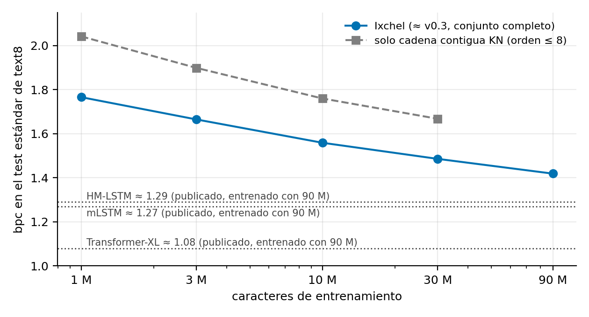
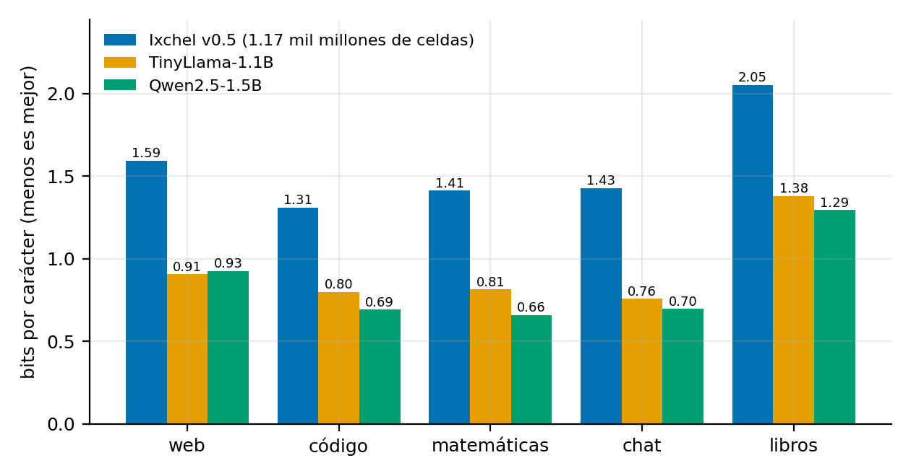

# Ixchel: modelado de lenguaje por mezcla de expertos de conteo, sin gradientes ni hiperparámetros ajustados, en CPU pura

**Preprint v1.0.** Noviembre de 2026. **Autor:** laboratório de pesquisa e desenvolvimento. **Licencia:** CC BY 4.0 (texto); el código del repositorio se distribuye bajo MIT. La exploración la realizaron agentes LLM bajo supervisión del autor (ver §3). Las cifras provienen de `experiments/*/REPORT.md`, de `ixchel/RESULTS_*.md` y de los JSON de cada carpeta; lo marcado **[pendiente]** aún no existe. En la §2 las referencias llevan una etiqueta: **[V]** verificada con búsqueda web (título, autores y venue), **[M]** citada de memoria y sin verificar.

## Resumen
Exploramos arquitecturas de modelado de lenguaje sin atención, sin retropropagación y sin optimizadores con tasa de aprendizaje, entrenables en una CPU de consumo. Comparamos siete familias —tablas con máscaras aleatorias de contexto, estado recurrente aleatorio con hashing de similitud, aprendizaje espectral por SVD, índice de sufijos de orden ilimitado, computación hiperdimensional, rasgos aleatorios con lectura en forma cerrada y bosques de contexto con parada MDL— en un corpus de nivel carácter (obras completas de Shakespeare, 5.36 M de caracteres) bajo un protocolo único con prueba anti-fuga. Seis de las siete quedan por detrás del n-grama con suavizado Kneser-Ney; el patrón común es que comprimir el contexto en un estado denso o aleatorio destruye la identidad exacta del contexto. La familia ganadora es el conteo exacto con Kneser-Ney modificado. Sobre ella construimos **Ixchel**: mezcla de cadenas de expertos de conteo, memoria en contexto (caché de historial) y combinación geométrica con pesos por máxima verosimilitud (Newton exacto, sin tasa de aprendizaje). Ixchel v0.3 alcanza **1.92 bpc** en Shakespeare con 20 M de pares de conteo y ~65 s de entrenamiento en CPU y, con el mismo contexto de 128 caracteres, mejora a una GRU de 0.84 M de parámetros entrenada con AdamW en **0.057 ± 0.014 bpc** (test pareado, una semilla). En text8 (90 M de caracteres) llega a 1.419 bpc, por detrás de las redes publicadas (≈1.08–1.29).

Escalamos a un corpus mixto de 686 M de caracteres (web, código, matemáticas, chat, libros) y construimos fuera de memoria un modelo de **1.17 mil millones de celdas** (16.9 GB, 89 min de pared en CPU de escritorio): 1.595 / 1.309 / 1.413 / 1.429 / 2.053 bpc por dominio, frente a 0.91–0.93 bpc en web de TinyLlama-1.1B y Qwen2.5-1.5B. **No generaliza:** 0/164 en HumanEval y 28.8 %, 56.5 % y 30.1 % en HellaSwag, PIQA y ARC-Easy (azar 25/50/25). Medimos el coste real de redes de pesos reales en la misma CPU (1.1 B: 33 tokens/s de entrenamiento, ≈19 años para 20 B de tokens), de modo que un modelo de uso general exige GPUs. Los optimizadores sin tasa de aprendizaje (DoG, Prodigy, CoinKT) no igualaron a AdamW en una GRU pequeña (DoG +0.099 bpc a 2600 pasos).

Probamos dos aplicaciones. (i) *Calidad de datos:* un n-grama KN barato puntúa tan bien o mejor que Ixchel completo, cuya caché puntúa el texto repetido como el más limpio; filtrar basura sintética con él mejora una GRU entrenada en 0.019 bpc (≈83 % del daño). (ii) *Compresión:* la cota de código ideal de Ixchel es 0.72× la del mejor compresor estándar de cada archivo y 0.80× la de PPMd, pero el modelo pesa 16.9 GB y un compresor real funciona a ≈50 caracteres/s. Concluimos que Ixchel es una línea base sin gradientes sólida y reproducible, con un estudio detallado de fallas, y no un producto por sí mismo. **Limitaciones principales:** una semilla o dos en las comparaciones con redes, degradaciones sintéticas en las pruebas de calidad de datos, resultados generados por agentes verificados parcialmente, y ninguna evidencia de competitividad con modelos de frontera.

## 1. Motivación y objetivos
Objetivo de ingeniería: un modelo de lenguaje que (i) se entrene en tiempo mínimo en CPU con muchos datos, (ii) no requiera búsqueda de hiperparámetros ni optimizadores, (iii) escale en parámetros añadiendo memoria (no cómputo de retropropagación), (iv) sirva inferencia barata. Esta es una exploración empírica con hipótesis falsables; el criterio de éxito es bits por carácter (bpc) en datos no vistos, junto con coste de entrenamiento e inferencia.

## 2. Trabajo relacionado
Estado de verificación: **[V]** = confirmado con búsqueda web (sesiones del 5 y 6 de noviembre de 2026); **[M]** = citado de memoria del autor del borrador, sin verificar (comprobar título, año y venue antes de enviar).
- n-gramas con suavizado: Witten & Bell, "The zero-frequency problem: Estimating the probabilities of novel events in adaptive text compression", *IEEE Trans. Inf. Theory* 37(4):1085–1094 (1991) **[V]**; Kneser & Ney, "Improved backing-off for M-gram language modeling", ICASSP 1995, pp. 181–184 **[V]**; Chen & Goodman 1999, "An empirical study of smoothing techniques for language modeling", *Computer Speech & Language* 13(4):359–393 (versión previa: Harvard TR-10-98) **[V]**; descuentos modificados con D1, D2, D3+ y conteos de continuación en todos los niveles salvo el más alto **[V]** (fórmulas exactas: comprobar en el artículo).
- Compresión por modelado de contexto: familia PAQ (Mahoney; PAQ8, mattmahoney.net/dc) y cmix (Knoll; derivado de PAQ8, github.com/byronknoll/cmix), ambos citados como software porque no se encontró un artículo formal **[V como software]**; PPM, Cleary & Witten, "Data compression using adaptive coding and partial string matching", *IEEE Trans. Commun.* 32(4):396–402 (1984) **[V]**; Context Tree Weighting, Willems, Shtarkov & Tjalkens, "The context-tree weighting method: basic properties", *IEEE Trans. Inf. Theory* 41(3):653–664 (1995) **[V]**.
- Aprendizaje en línea sin parámetros por apuestas de monedas: Orabona & Pál, "Coin Betting and Parameter-Free Online Learning", NeurIPS 29 (2016), pp. 577–585 **[V]**.
- Optimizadores sin tasa de aprendizaje: DoG, Ivgi, Hinder & Carmon, "DoG is SGD's Best Friend: A Parameter-Free Dynamic Step Size Schedule", ICML 2023, PMLR 202:14465–14499 **[V]**; Prodigy, Mishchenko & Defazio, "Prodigy: An Expeditiously Adaptive Parameter-Free Learner", ICML 2024, arXiv:2306.06101 **[V]**. El artículo de DoG reporta resultados cercanos a SGD afinado en ajuste fino de visión y lenguaje y que la variante por capa se acerca a Adam afinado; nuestras pruebas (§11) son de entrenamiento desde cero con una GRU pequeña.
- Compresores de referencia: PPMd, Shkarin, "PPM: one step to practicality", Data Compression Conference 2002, pp. 202–211 **[V título y venue]**; zstd, brotli, bzip2 y xz se usan como software (sin referencia formal; no se verificaron sus versiones ni autores) **[M]**.
- Modelos y bancos de evaluación: Qwen2.5, Qwen Team, "Qwen2.5 Technical Report", arXiv:2412.15115 **[V]**; TinyLlama, Zhang, Zeng, Wang & Lu, "TinyLlama: An Open-Source Small Language Model", arXiv:2401.02385 **[V]**; HellaSwag, Zellers et al., ACL 2019, pp. 4791–4800 **[V]**; ARC, Clark et al., arXiv:1803.05457 **[V]**; PIQA, Bisk, Zellers, Le Bras, Gao & Choi, "PIQA: Reasoning about physical commonsense in natural language", AAAI 2020, arXiv:1911.11641 **[V]**; HumanEval, Chen, Tworek et al., "Evaluating Large Language Models Trained on Code", arXiv:2107.03374 (2021) **[V]**; C4, Raffel et al., JMLR 21(140):1–67 (2020) **[V]**; GSM8K, Cobbe et al., arXiv:2110.14168 (2021) **[V]**; Dolly (*databricks-dolly-15k*, Databricks, 2023; licencia CC BY-SA 3.0 según su ficha, con material de Wikipedia en algunas categorías) **[V]**.
- Redes con capa oculta fija: ELM, Huang, Zhu & Siew, "Extreme learning machine: theory and applications", *Neurocomputing* 70:489–501 (2006) **[V]**; random features, Rahimi & Recht, "Random features for large-scale kernel machines", NIPS 2007 (*Advances in NIPS* 20) **[V]**; reservorios/ESN, Jaeger, "The echo state approach to analysing and training recurrent neural networks", GMD Report 148 (2001; existe una versión corregida de 2010 y una fe de erratas de 2020) **[V]**.
- Hiperdimensional y memoria distribuida dispersa: Kanerva, *Sparse Distributed Memory*, MIT Press (1988) **[V]**; Kanerva, "Hyperdimensional computing: an introduction", *Cognitive Computation* 1:139–159 (2009) **[V]**.
- Aprendizaje espectral de HMM: Hsu, Kakade & Zhang, "A spectral algorithm for learning hidden Markov models", COLT 2009 **[V]**.
- Bosques aleatorios para modelado de lenguaje: Xu & Jelinek, "Random forests in language modeling", EMNLP 2004, pp. 325–332 **[V]**.
- Orden ilimitado con arreglo de sufijos: Liu et al., "Infini-gram: Scaling Unbounded n-gram Language Models to a Trillion Tokens", COLM 2024; 7 bytes/token de índice, latencia <20 ms por consulta; interpolado con LMs neuronales reduce la perplejidad hasta 73 % **[V]**.
- Referencias neuronales: Transformer, Vaswani et al., "Attention is all you need", NIPS 2017 **[V]**; GRU, Cho et al., "Learning phrase representations using RNN encoder–decoder for statistical machine translation", EMNLP 2014, pp. 1724–1734 **[V]**; AdamW, Loshchilov & Hutter, "Decoupled weight decay regularization", ICLR 2019 **[V]**.
- Referencias de text8 (nivel carácter, 90 M/5 M/5 M): Transformer-XL, Dai et al., ACL 2019, pp. 2978–2988 (24 capas, 277 M parámetros): 1.08 bpc (1.085 en algunas tablas) **[V]**; Transformer profundo de 64 capas, Al-Rfou et al., "Character-level language modeling with deeper self-attention", AAAI 2019: 1.13 **[V]**; mLSTM, Krause et al., "Multiplicative LSTM for sequence modelling", ICLR 2017: 1.27 en su variante regularizada **[V]**; HM-LSTM, Chung et al., "Hierarchical multiscale recurrent neural networks", ICLR 2017: 1.29 con normalización de capa, según la tabla del artículo **[V parcial: resumen de búsqueda]**. Las cifras se confirmaron en las páginas o resúmenes de los artículos originales; conviene contrastarlas con sus tablas antes de publicar. Resultados publicados de cmix/paq8 sobre text8 **no se encontraron** en la búsqueda: no los citamos.
**Aviso de novedad:** Ixchel combina técnicas conocidas (KN, mezcla de contextos, EM, caché de historial como en LMs con caché). No afirmamos novedad en sus componentes aislados; la contribución propuesta es la combinación sin hiperparámetros ajustados, el estudio sistemático de fallas de familias alternativas bajo un mismo protocolo y la medición de escalado/CPU. La novedad real debe evaluarse contra PAQ/cmix e infini-gram antes de publicar; solo PPMd se probó como competidor de compresión (§13.2–13.3).

## 3. Protocolo experimental
- **Datos:** Project Gutenberg #100 (Complete Works of William Shakespeare), cabecera/pie retirados, 5,360,370 caracteres, V=96. Partición contigua: 4,824,333 train / 536,037 val (último 10%).
- **Métrica:** bpc sobre `n_eval` posiciones equiespaciadas de val (20k–50k; 10k para modelos neuronales por coste de inferencia), sin adaptación durante la evaluación. Azar: 6.58 bpc.
- **Anti-fuga:** `leak_check` corrompe `val[pos:]` y exige predicciones idénticas; todos los resultados reportados tienen `leak_free=True`.
- **Anti-trampa:** `val` solo para el reporte final; toda elección (rangos, regularización, pesos de mezcla) usa un dev interno del train (último 5%).
- **Hardware:** AMD Ryzen 7 7730U (8 núcleos/16 hilos), 31 GB RAM, Windows 11, Python 3.14, numpy/numba. Los experimentos de ronda 1 corrieron concurrentemente (8 agentes, 2 hilos c/u): los tiempos están contaminados.
- **Experimentos posteriores (§10–§13):** mismo principio (tablas y pesos de mezcla ajustados sin ver la validación; validación solo para el reporte; comparaciones pareadas sobre las mismas posiciones con error estándar por bloques de 500). Corpus mixtos de caracteres ASCII (vocabulario 97), validación por dominio, y las mismas pruebas de opción múltiple y HumanEval para Ixchel y los modelos de referencia (§10.2).
- **Muestreo:** temperatura 1.0 (sin top-k).
- **Metodología de exploración:** agentes LLM (Claude Haiku) implementaron cada MVP bajo un briefing común; los informes se transcribieron sin editar cifras; el autor principal verificó la coherencia entre cifras y JSON de los casos decisivos **[pendiente: re-verificación independiente de todos los MVP]**.

## 4. Ronda 1: siete familias sin gradientes + referencia neuronal
Tabla (bpc val; detalle en `experiments/ROUND1_SUMMARY.md`):

| Familia (nombre maya) | Mejor bpc | Params/celdas | Fit | Veredicto |
|---|---|---|---|---|
| n-gram Witten-Bell orden 5 (referencia) | 2.269 | 1.08M | 0.6 s | |
| Tz'ib: índice de sufijos, KN cerrado orden 5 | 2.185 | 0.41M | ~40 s índice | gana; orden ilimitado memoriza |
| Tzolk'in: ensamble de tablas con máscaras | 2.214 (contiguo) / 2.940 (aleatorio) | 14.7M / 21.7M | 17 s | máscaras aleatorias fallan |
| Ik': espectral (SVD) + WB | 2.213 mezcla / 3.20 puro | 17.9M | 56 s | ganancia = la mezcla |
| Yax Che': bosque MDL (B=64) | 2.390 | 19.65M | 421 s | pierde con WB-5 |
| Ixim: ridge sobre n-gramas (control) / aleatorios | 2.630 / 4.334 | 0.2M | 351 s / 615 s | representación aleatoria destruye contexto |
| Chan: HDC + WB | 3.870 | 30.5M | 86 s | sketch ruidoso de tabla de conteo |
| Pixan: reservorio + SimHash | 4.144 | 29.5M | 52 s | buckets mezclan contextos |
| GRU 0.84M, AdamW, 8 min | 2.314 | 0.84M | 480 s | referencia neuronal |
| Transformer 0.82M, AdamW, 8 min | 3.593 | 0.82M | 480 s | muy subentrenado (0.4 épocas) |

### 4.1 Hallazgos y fallas (para discusión)
1. **Compresión del contexto en estado denso/aleatorio** (Pixan, Ixim aleatorio, Chan): 1.5–2 bpc peor que el conteo exacto. Mecanismos medidos: interferencia al sumar vectores aleatorios (Ixim: 4.33 vs 2.63 con rasgos de n-gramas exactos y la misma lectura); buckets SimHash con ~73 posiciones que mezclan siguientes-caracteres distintos (Pixan); error de conteo proporcional a √(N/(D·H)) en HDC (Chan).
2. **Orden ilimitado + suavizado Witten-Bell memoriza** (Tz'ib: WB-inf 3.12 bpc, 100 % de la salida copiada del train); KN con descuentos cerrados limita el daño (2.318) pero no supera al tope de orden 5.
3. **Máscaras aleatorias de contexto** no aportan sobre el contiguo (2.94 vs 2.21); más tablas *empeoran* con mezcla ingenua (dilución).
4. **Más árboles/dimensiones rinden poco**; más *datos* rinden estable (~−0.08 bpc por duplicar en KN-5).
5. **La SVD supera a la proyección aleatoria** (3.37 vs 4.31 puro) pero en mezcla la ventaja es 0.04 bpc.
6. **Solución cerrada densa no compite con contar**: ridge sobre n-gramas: 2.63 bpc en 351 s vs n-gram en 0.6 s.
7. Fallas de implementación/proceso registradas: KN dio probabilidad cero con D=0 (Tz'ib); embedding N(0,1) atado produjo 39 bpc (baseline neuronal); contadores calculados antes del fit (Tzolk'in); masa negativa estructural en lecturas lineales (Ik'); sweeps en segundo plano que contaminaron CPU.
8. Alegaciones de "cero hiperparámetros" **no se sostuvieron en ninguna familia** salvo KN/WB: Tzolk'in (7 libres), Pixan (4), Ixim (~5), Chan (5), Yax Che' (5–6), Ik' (4 efectivas).

## 5. Ixchel v0.1 (arquitectura)
Descripción en `ixchel/core.py`. Átomos discretos del pasado → cadenas de niveles de contexto → KN modificado jerárquico con descuentos D1, D2, D3+ cerrados (Chen & Goodman) **[verificar]** → mezcla lineal con pesos por EM y compuerta discreta (nivel más largo visto, conteo). Entrenamiento: contar (93k–180k caracteres/s con 4 hilos contaminados) + EM sobre 150k posiciones dev + recontar con todo el train.

Resultados (val, n_eval=20k): A (contigua, órdenes 0–8) 2.126; A+W (palabras) 2.104; A+W+S (clases) 2.079; A+W+S+L (línea) **2.078** con 15.6M pares; sin compuerta 2.086.

## 6. Ronda 2: extensiones de Ixchel (cinco agentes en paralelo)
Cada línea se midió contra la base v0.1 (2.0784 bpc, n_eval=20k). Detalle en `experiments/r2_*/REPORT.md`.

| Línea | Mejor resultado | Veredicto |
|---|---|---|
| Caché en contexto (`r2_cache`): WB-4 sobre ventanas 256/1024/4096/∞ del propio historial | 2.0784 → 1.9615 (−0.117) con mezcla lineal | Mayor avance de la ronda; crece con la ventana; el *match model* no aporta encima |
| Mezclador (`r2_mixer`): producto de expertos con pesos globales por Newton exacto | 2.0784 → 2.0391 (−0.039) | Se fusiona; compuerta fina, SSE y 2 capas no aportan o fallan |
| Léxico/estructura (`r2_lexstruct`): hablante, verso, saltos, mayúsculas | −0.030 con combo de 5 cadenas (mezcla lineal) | Ganan los saltos que conservan c1; hablante y verso casi nada |
| Clases por conteo (`r2_classes`): clusters de palabras, clases de carácter | clusters: 0; 4 clases de carácter: −0.013 | Los clusters de palabras no ayudan; la ganancia de una cadena aislada no se traslada a la mezcla |
| Escala (`r2_scale`): curva por datos, throughput, memoria | −0.07 a −0.10 bpc por duplicar datos; optimizaciones exactas 2.2–2.6× | Sin meseta visible en 0.3–4.8 M de caracteres; piso no acotado |

### 6.1 Ixchel v0.2 y v0.3 (fusión)
v0.2 = v0.1 + caché (ventanas 256/1024/4096/∞) + mezcla geométrica global; v0.3 = v0.2 + cadenas Kb, Kc, WL, W2. (n_eval=20k, val; `ixchel/RESULTS_v02.md`)
| Config | bpc | pares | 
|---|---|---|
| v0.1 (EM con compuerta) | 2.0784 | 15.65M |
| v0.2 sin caché (PoE) | 2.0388 | 15.65M |
| v0.2 caché 128 (= contexto de la GRU) | 2.0288 | 15.65M |
| v0.2 caché 256+1024 | 1.9971 | 15.65M |
| v0.2 caché 1024+∞ | 1.9307 | 15.65M |
| v0.2 caché 4 ventanas | 1.9247 | 15.65M |
| v0.3 (+ cadenas léxicas, caché 4 ventanas) | 1.9199 | 20.1M |
Hallazgos de la fusión: (i) los efectos NO son aditivos: con mezcla geométrica las cadenas léxicas rinden −0.005 en lugar de −0.030; (ii) la mezcla geométrica asigna pesos negativos a algunas cadenas (L, WL, Kb): actúan como correctores; (iii) la ganancia del caché depende de la longitud de ventana (128: −0.010; 1024+∞: −0.108), es decir, de cuánto texto previo se repite en el documento.

## 7. Comparación neuronal
GRU de 2 capas, d=256 (0.84 M parámetros), AdamW, contexto 128. A 8 min con 2 hilos (CPU compartida): 2.314 bpc (n_eval=10k). A 30 min con 8 hilos (también bajo contención): **2.070 bpc**, 4.6 épocas, 11,381 CPU-s. Transformer de 0.82 M a 8 min: 3.593 (0.4 épocas, muy subentrenado). Con el mismo contexto de 128 caracteres, Ixchel v0.2 da 2.029 con ~55 CPU-s (≈200× menos CPU). **Salvedades:** una sola semilla; GRU no convergida ni barrida en tamaño; evaluación con n_eval distinto (ver §14 y tabla final con error estándar); la GRU solo ve 128 caracteres y el caché de Ixchel hasta todo el historial.

## 7b. Tabla final con error estándar (`ixchel/results/final_eval.json`, Ixchel v0.3, 20.1 M pares, fit 63–70 s)
Las posiciones de n_eval=10,000 son EXACTAMENTE las que usó la GRU (rejilla equiespaciada determinista).
| Config | bpc (10k) | bpc (50k) | SE iid (10k / 50k) | SE por bloques de 500 (10k / 50k) |
|---|---|---|---|---|
| v0.3 caché largo (256/1024/4096/∞) | 1.9233 | 1.9183 | 0.021 / 0.009 | 0.036 / 0.016 |
| v0.3 caché 128 (contexto igual a la GRU) | 2.0336 | 2.0256 | 0.021 / 0.010 | 0.041 / 0.017 |
| v0.3 sin caché | 2.0363 | 2.0304 | 0.021 / 0.010 | 0.041 / 0.017 |
| GRU 0.84 M, 30 min, 8 hilos | 2.0702 | — | n/d | n/d |
| GRU 0.84 M, 8 min, 2 hilos | 2.314 | — | n/d | n/d |
**Test pareado (mismas 10,000 posiciones; `ixchel/RESULTS_paired.md`).** Reentrenamos la GRU con presupuesto fijo de 2600 pasos (semilla 0, pesos guardados; val 2.0905 bpc; el 2.070 anterior era otra corrida por tiempo de pared). Diferencia GRU − Ixchel posición a posición: **+0.057 ± 0.014** bpc con el mismo contexto de 128 caracteres (≈4 SE; Ixchel mejor) y **+0.167 ± 0.018** con el caché largo (SE por bloques de 500 posiciones). Los niveles absolutos tienen un SE de ~0.036–0.041 (variación entre pasajes del texto), por eso solo las diferencias pareadas son informativas.
| comparación pareada (misma rejilla de 10 000 posiciones) | diferencia (bpc) | SE por bloques |
|---|---|---|
| GRU − Ixchel v0.3 (mismo contexto 128) | +0.057 (Ixchel mejor) | 0.014 |
| GRU − Ixchel v0.3 (caché largo) | +0.167 | 0.018 |
| Ixchel(ctx 128) − ensamble Ixchel+GRU | +0.064 | 0.006 |
| Ixchel(caché largo) − ensamble Ixchel+GRU | +0.040 | 0.005 |
Ixchel supera a la GRU en el 51.3 % (ctx 128) y el 55.7 % (caché largo) de las posiciones.
**Ensamble Ixchel + GRU** (mezcla geométrica con 2 pesos ajustados en dev que ninguno de los dos vio): 1.970 (ctx 128) y 1.884 (caché largo), es decir −0.064 ± 0.006 y −0.040 ± 0.005 frente a Ixchel solo. Los modelos son complementarios de forma significativa, aunque la ganancia es moderada con una red de solo 0.84 M de parámetros.
**Salvedades:** una sola semilla de GRU (la variación entre dos corridas fue ~0.02), un solo tamaño, ~4.6 épocas, sin convergencia; una red mayor o más entrenada reduciría o invertiría la ventaja; un único corpus. Los regímenes de cómputo son muy distintos (GRU: 6,219 CPU-s en esta corrida; Ixchel: ~65–120 CPU-s).

## 8. Auditoría de hiperparámetros de Ixchel v0.1
Constantes libres: orden máximo de la cadena A (8), niveles de las cadenas W/S/L (diseño a mano), fracción dev (5 %), nº de posiciones dev (150k), iteraciones EM (60), `prior_m`=1 (shrinkage de pesos de compuerta), cubetas de conteo de la compuerta (1, 2–3, 4–15, 16+), clases de caracteres (8, a mano), t0=16. Derivadas de datos: descuentos D1–D3, pesos de mezcla. **No es "cero hiperparámetros"**: son pocas, discretas y de diseño, no continuas ni sensibles; se reportará su sensibilidad **[pendiente]**. Las versiones posteriores añaden constantes de diseño: el orden de la caché (8), las ventanas (256/1024/4096/∞), los átomos de código y sus niveles (§11), el reparto de repeticiones del corpus `big2` (matemáticas ×6, chat ×4, libros ×6; §10.2) y la elección de qué cadenas incluir; los descuentos de KN y los pesos de la mezcla siguen derivándose de los datos.

## 9. Escalabilidad (`experiments/r2_scale`)
- **Datos** (cadena A / AWSL, val, 20k): 6 % del train 2.505 / 2.468; 12.5 % 2.385 / 2.336; 25 % 2.298 / 2.252; 50 % 2.224 / 2.175; 100 % 2.126 / 2.078. Cada duplicación ≈ −0.07 a −0.10 bpc. Ajuste bpc = a·N^−b + c (5 puntos): b = 0.11 ± 0.09 (A), 0.16 ± 0.11 (AWSL); piso c = 1.1 ± 1.0 / 1.4 ± 0.6. **El ajuste no está bien condicionado (5 puntos, 1.5 octavas): las extrapolaciones 1.6–1.9 bpc con 10–1000× datos son orientativas, no predicciones.** Pares de tabla proporcionales a N^0.75–0.78.
- **Velocidad** (AWSL, 16 hilos compartidos): recuento 105–135 k car/s → 235–290 k car/s con tres optimizaciones exactas (radix sort, índice hash, átomos solo en posiciones pedidas; probabilidades idénticas bit a bit). Inferencia en lote de 4096 posiciones: 17 k → 35 k pos/s (1 hilo) y 37 k → 103 k pos/s (4 hilos). Generación carácter a carácter: ~4.8 k car/s por hilo (el paralelismo no ayuda).
- **Memoria:** 15.5 B/par (15.65 M pares = 243 MB); cuantizar los conteos a 7 bits cuesta +0.0003 bpc, a 5 bits +0.0025. Latencia de búsqueda sintética: 582 → 111 ns (binaria → hash) a 10 M contextos y 889 → 172 ns a 100 M.
- **Proyección (extrapolación lineal, no medida):** 1 B de pares ≈ 15.5 GB (7.3 GB compacto) y ~1 GB de texto; 10 B ≈ 155 GB (73 GB). Lo que Shakespeare permite afirmar: la curva baja monótonamente hasta 4.8 M de caracteres. Lo que no: el piso, ni que 10⁹ pares alcancen a una red pequeña en un corpus mayor.

### 9.1 Escala en un corpus 20× mayor: text8 (`ixchel/RESULTS_text8.md`)
text8 (Mahoney): 100 M de caracteres, 27 símbolos (a–z y espacio), partición estándar 90 M/5 M/5 M; entrenamos con el prefijo de N caracteres y probamos siempre en el último bloque de 5 M (test estándar), n_eval=50,000. Sin cadena de línea (no hay saltos de línea). "A" = cadena contigua KN orden ≤8; "full" = A, W, S, Kb, Kc, WL, W2 + caché de 4 ventanas + mezcla geométrica (≈ v0.3).
| train (chars) | A bpc | A pares | full bpc | full pares | full fit (s, pared) | full RAM pico |
|---|---|---|---|---|---|---|
| 1 M | 2.042 | 1.6 M | 1.766 | 4.6 M | 12 | 0.7 GB |
| 3 M | 1.899 | 3.5 M | 1.665 | 10.8 M | 46 | 1.5 GB |
| 10 M | 1.760 | 8.1 M | 1.559 | 27.1 M | 126 | 3.9 GB |
| 30 M | 1.668 | 16.2 M | 1.486 | 62.2 M | 370 | 10.3 GB |
| **90 M (train estándar)** | — | — | **1.419** | 142.9 M | 1015 | 15.0 GB |
Pendiente por duplicación de datos (full): −0.064, −0.061, −0.046 (se achica); (A): −0.090, −0.080, −0.058. Ajuste a·N^−b + c con 4 puntos y 3 parámetros: full b=0.13±0.05, c=0.98±0.23; extrapolación a 90 M ≈ 1.42 (orientativa). **Lectura honesta:** (i) la mejora con los datos es real pero decreciente; (ii) el conjunto completo de expertos y caché gana 0.18–0.28 bpc sobre la cadena contigua sola con los mismos datos; (iii) la referencia publicada de redes entrenadas con los 90 M completos (Transformer-XL ≈1.08; mLSTM ≈1.27; HM-LSTM ≈1.29, **[V]**) está por debajo de lo que el ajuste proyecta para Ixchel con 90 M, es decir, **el conteo exacto con estos expertos no alcanza a esas redes**, aunque entrena en minutos de CPU en lugar de días de GPU. La generalización entre contextos parecidos que aportan los embeddings es la pieza que nos falta.
**Punto de 90 M completos: 1.4193 bpc** (143 M de pares, 1015 s de entrenamiento con 4 hilos, 15 GB de RAM pico, test estándar, n_eval=50k): el ajuste hecho solo con 1–30 M predecía 1.417 (un único punto de validación de la extrapolación; sigue sin acotar el piso). Queda ~0.14 bpc sobre la mLSTM publicada y ~0.34 sobre Transformer-XL. **[pendiente: GRU entrenada con presupuesto de CPU equivalente en text8]**

## 10. Corpus mixto y modelo grande

### 10.1 Ixchel v0.4 y el corpus mixto `mix1` (`ixchel/RESULTS_mix1.md`, `RESULTS_mix1_final.md`)
v0.4 añade una caché de historial de orden 8 con cuatro ventanas (256/1024/4096/∞); en Shakespeare: 1.9125 bpc (10 k). Corpus `mix1`: 85.6 M de caracteres ASCII (vocabulario 97): web C4, código Python local (validación = scipy + networkx retenidos), GSM8K, Dolly y Shakespeare. Con ~200 M de pares: web 1.693, código 1.405, matemáticas 1.415, chat 1.522, libros 1.995 bpc; HellaSwag 28.2 %, PIQA 54.7 %, ARC-Easy 29.4 %.

### 10.2 Modelo grande: `big1` y `big2` con Ixchel v0.5 (`ixchel/RESULTS_big1_build.md`, `RESULTS_big2_eval.md`)
**Construcción fuera de memoria** (`bigbuild.py`): lectura en trozos con volcado a disco, pares únicos por trozo y reducción en 32 particiones por rango de clave; los conteos de continuación se deduplican por los 32 bits altos de la clave de par. Verificado idéntico bit a bit al método en memoria a 1.5 M de caracteres (una primera versión que deduplicaba por los 32 bits bajos produjo tablas distintas por colisiones y se descartó).
**`big1`:** 690.6 M de caracteres, 913.7 M de pares, 13.6 GB, 38 min de construcción. **Falla de protocolo:** el chat de validación quedó contaminado en el entrenamiento (barajado con otro estado del generador aleatorio); la cifra de chat de `big1` es inválida y está marcada como tal.
**`big2`:** se excluyen por contenido los 752 documentos de chat de validación; se repiten matemáticas ×6, chat ×4 y libros ×6 para corregir la dilución de dominios (proporciones web 57.9 / código 27.6 / matemáticas 3.5 / chat 6.8 / libros 4.2 %; 686.1 M de caracteres de entrenamiento, 655.2 M con repetición). **Ixchel v0.5** = v0.4 + seis cadenas de átomos de código podadas (CK, CB, CI, CF, CS, CSK; ver §11): 1 172 685 336 celdas, 16.9 GB, 89 min de pared en dos tandas, ajuste de la mezcla 109.5 s.
| dominio | big1 (v0.4) | big2 (v0.5) | Qwen2.5-1.5B | TinyLlama-1.1B |
|---|---|---|---|---|
| web | 1.593 | 1.595 | 0.925 | 0.905 |
| código | 1.355 | 1.309 | 0.692 | 0.798 |
| matemáticas | 1.468 | 1.413 | 0.659 | 0.815 |
| chat | inválido | 1.429 | 0.696 | 0.757 |
| libros | 2.062 | 2.053 | 1.294 | 1.380 |
El cambio `big1`→`big2` mezcla dos factores (v0.5 y el corpus rebalanceado); no se pueden separar. Los modelos de referencia se midieron con 24 segmentos × 1500 caracteres de la validación de `mix1`, no sobre las mismas 30 000 posiciones; la comparación es de orden de magnitud. Los modelos abiertos pudieron haber visto el texto de evaluación (no verificado).

| prueba | Ixchel `big2` | azar | Qwen2.5-1.5B | TinyLlama-1.1B |
|---|---|---|---|---|
| HellaSwag acc_norm | 28.8 % (n=5000, SE 0.6) | 25 | 67.2 (n=500) | 58.4 (n=500) |
| PIQA acc_norm | 56.5 % (n=1838, SE 1.2) | 50 | 77.5 (n=400) | 73.0 (n=400) |
| ARC-Easy acc_norm | 30.1 % (n=2376, SE 0.9) | 25 | 70.5 (n=400) | 57.3 (n=400) |
| HumanEval pass@1 | **0/164** | – | 37.2 % | 0.6 % |
Sintaxis válida en las generaciones de código: 15 % frente a 27.5 % de la continuación real (n=120). Inferencia: ≈9.2 k posiciones/s en la evaluación (2.05 ms/posición). **Lectura:** el aumento de datos y tamaño reduce los bpc pero no hace aparecer capacidad de razonamiento ni de programación.

## 11. Variaciones de las rondas 3 y 4 (`experiments/r3_*`, `r4_*`)
| variante | resultado | decisión |
|---|---|---|
| Átomos de código `prune` (`r4_codeatoms`) | pareado vs base en `mix15`: web −0.013, código −0.048, matemáticas −0.038, chat −0.017, libros −0.015 bpc (SE ≤0.002); +25 % de celdas. El conjunto completo costaba +45 % y rendía menos; los átomos de indentación perjudican | **fusionado (v0.5)** |
| Compuerta por dominio (`r4_gate`) | `cl`: código −0.057, matemáticas −0.012, **libros +0.016**; la variante elegida por validación cruzada (`alev`) colapsa al vector global (τ²=0), inestabilidad del encogimiento | no fusionada |
| Bucles de generación (`r4_loops`) | ninguna receta sin constantes mejora la generación; la receta que retira la predicción repetida empeora el bpc sobre texto real (código +0.164); Qwen premia la repetición (T=0.8), por lo que la perplejidad sola no mide calidad; a T=1.0 el texto es ininteligible (Qwen: 3.2 bits/car frente a 0.83 del texto real) | no fusionada |
| Residuo neuronal pequeño (`r3_residual`) | GRU de 37 k parámetros sobre Ixchel v0.3: 1.9233 → 1.8968 (mejora 0.027, SE 0.02/0.008), **no iguala** al ensamble con la GRU de 0.84 M (1.8835); depende de AdamW | no fusionado |
| Optimizadores sin tasa de aprendizaje (`r3_lrfree`) | GRU 0.84 M, 2600 pasos: AdamW 2.0905; **DoG 2.1898 (+0.099)**; Prodigy 2.3402 (+0.250; d queda estancado); CoinKT 3.604 (escala inicial mal calibrada). Una sola semilla; DoG seguía mejorando (no se midió con más pasos) | AdamW sigue por delante |
Falla de proceso: los agentes ejecutores no pueden escribir informes; el orquestador los transcribió y marcó donde eran incompletos.

## 12. Coste medido de redes de pesos reales (`experiments/REAL1B_REFERENCE.md`)
Decodificador tipo Llama con pesos aleatorios (el coste no depende de los valores), 8 hilos, fp32, esta CPU:
| red | parámetros | entrenar tok/s | decodificar tok/s | RAM pico |
|---|---|---|---|---|
| 39 M | 38.7 M | 895 | 59.0 | 1.4 GB |
| 134 M | 134.1 M | 293 | 31.1 | 2.8 GB |
| 374 M | 373.9 M | 97.8 | 12.0 | 6.7 GB |
| 1.1 B | 1100.0 M | 33.2 | 5.19 | 19.0 GB |
El rendimiento satura en ≈190 GFLOP/s. Con la fórmula 6·N·T (N sin embeddings), una red de 1 B con 20 B de tokens cuesta ≈1.2·10²⁰ FLOPs, ≈19 años en esta CPU; un 7 B con 1 T de tokens, ≈6 400 años. **[SUPUESTO, no medido]** En GPU tipo H100 (≈3.5·10¹⁴ FLOP/s efectivos y 2 USD/h, a cotizar), esos objetivos serían ≈92 GPU-horas (≈185 USD) y ≈31 000 GPU-horas (≈62 000 USD) de cómputo ideal. Ixchel decodifica ≈5 k caracteres/s por hilo (motor incremental exacto), unos tres órdenes de magnitud más rápido por núcleo, pero con una capacidad mucho menor.

## 13. Aplicaciones: calidad de datos y compresión

### 13.1 Puntuación de calidad de datos (`ixchel/niche1_*.py`, `experiments/GO_TO_MARKET.md` §3.1)
Diseño y regla de decisión fijados antes de ver resultados. 500 documentos de un shard de C4 no usado en el entrenamiento (1000 caracteres cada uno); puntuación = bpc; comparación de Ixchel v0.5 completo, el n-grama KN simple (cadena A, mismos datos) y la tasa de compresión zlib.
| degradación (AUC limpio vs degradado) | Ixchel | n-grama KN | zlib |
|---|---|---|---|
| ruido 2 % | 0.940 | 0.950 | 0.635 |
| ruido 10 % | 0.998 | 0.997 | 0.934 |
| palabras barajadas | 0.974 | 0.984 | 0.623 |
| texto repetido | **0.000** | 0.796 | 0.000 |
| empalme de dos documentos | 0.629 | 0.555 | 0.701 |
Spearman con el bpc de Qwen2.5-1.5B (200 documentos): Ixchel 0.687, KN 0.592, zlib 0.437; la diferencia pareada Ixchel−KN (+0.095, IC95% [0.043, 0.150]) es un análisis post hoc. **Resultado:** la regla de decisión fijada no se cumple (en ruido y palabras barajadas empatan o gana el n-grama). **Falla:** la caché de historial hace que Ixchel puntúe el texto repetido como el más limpio. Ningún puntuador detecta bien la incoherencia entre documentos. Limitaciones: degradaciones sintéticas, proxy de Qwen, n=200, no se midió el efecto en un modelo entrenado con y sin filtro.
**Seguimiento sin caché.** Reajustando los pesos con solo los 14 expertos de conteo (sin caché de historial): AUC en texto repetido 0.806 [0.784, 0.827] (con caché 0.000); en el resto de degradaciones es indistinguible del n-grama KN (ruido 2 %: 0.943 frente a 0.950; palabras barajadas: 0.978 frente a 0.984; empalme: 0.551 frente a 0.555); Spearman con Qwen 0.612 (con caché 0.687, KN 0.592). La diferencia bpc sin caché − bpc con caché detecta la repetición sintética con AUC 1.000 pero también se activa con otras degradaciones. La cadena A sola ocupa ≈3.3 GB (estimación proporcional a los pares). Conclusión: un n-grama KN de pocos GB basta para estas degradaciones; la caché aporta sensibilidad al empalme y a la correlación con Qwen.

### 13.2 Compresión: cota de código ideal (`ixchel/niche4_compress.py`)
Longitud de código ideal (cota de Shannon; sin codificador aritmético implementado) de Ixchel v0.5 sobre los archivos de validación completos (0.5–1 M de caracteres por dominio, no usados en el entrenamiento) frente a compresores estándar:
| dominio | Ixchel (bytes) | mejor estándar (bytes) | compresor | razón |
|---|---|---|---|---|
| web | 200 012 | 308 072 | zstd-19 + diccionario 1 MB | 0.65 |
| código | 167 247 | 200 746 | brotli 11 | 0.83 |
| matemáticas | 130 440 | 183 010 | bzip2 9 | 0.71 |
| chat | 113 173 | 184 407 | zstd-19 + diccionario 1 MB | 0.61 |
| libros | 139 418 | 167 167 | bzip2 9 | 0.83 |
Total: 750 290 frente a 1 043 402 bytes (razón 0.72); xz 9e queda entre 1.60 y 2.81 bpc frente a 1.31–2.08 de Ixchel. **Condiciones:** el modelo pesa 16.9 GB, de modo que, contado como parte del descompresor, el equilibrio exige ≈160–560 GB de texto similar; la velocidad es ≈16–20 k caracteres/s (≈100× más lento que los compresores estándar); no se probaron compresores de mezcla de contextos ni redes, y la ventaja procede de haber visto 656 M de caracteres de la misma distribución. Se informa el límite teórico, no un compresor funcional.

### 13.3 Entrenar con y sin filtro; compresor real (`ixchel/filter_*.py`, `niche4_coder.py`, `niche4_ppmd.py`)
**Filtrado de datos.** Pool de 8000 documentos de C4 (1000 caracteres; shard no usado por Ixchel), 400 documentos distintos para evaluar; GRU de 0.84 M de parámetros (AdamW, control estándar), 1200 pasos × lote 32 × contexto 128 en todos los brazos, 2 semillas. Pool contaminado: 30 % de los documentos sustituidos por una versión degradada (ruido 10 %, palabras barajadas, repetición, empalme). bpc medio sobre los documentos de evaluación:
| brazo | bpc |
|---|---|
| limpio, todos | 2.2130 |
| limpio, 50 % al azar | 2.2168 |
| limpio, 50 % de menor bpc | 2.2372 |
| limpio, 50 % de mayor bpc | 2.2300 |
| contaminado, sin filtrar | 2.2416 |
| contaminado, filtro n-grama KN | 2.2226 |
| contaminado, filtro Ixchel completo | 2.2287 |
| contaminado, oráculo (quitar los degradados) | 2.2185 |
Diferencias pareadas por documento (SE por documento): sin filtrar − oráculo +0.0231 (0.0013); filtro KN − sin filtrar −0.0191 (0.0026); filtro Ixchel − sin filtrar −0.0130 (0.0019); **filtro KN − filtro Ixchel −0.0061 (0.0016)**; con datos limpios, quedarse con el 50 % de menor o de mayor bpc empeora frente al azar (+0.020 y +0.013). El orden entre brazos se repite en las dos semillas, cuya dispersión llega a 0.011. El filtro de Ixchel deja pasar toda la repetición (629/629) porque su caché la puntúa como texto limpio; el de KN deja 254/629. **Conclusión:** filtrar basura mejora el modelo entrenado (efecto pequeño: recupera ≈83 % del daño), pero lo consigue un n-grama KN barato; Ixchel completo no aporta. Limitaciones: basura sintética, tasa de basura conocida por el filtro, un corpus, GRU diminuta, 2 semillas.

**Compresor real.** PPMd (mejor de los órdenes 8, 16 y 32) sobre los archivos de §13.2: web 270 013, código 182 803, matemáticas 161 688, chat 165 447, libros 152 278 bytes; Ixchel queda entre 8 % y 32 % por debajo (no 17–39 %). Con un codificador aritmético entero de 32 bits y frecuencias cuantizadas, la ida y vuelta sobre extractos de 20 000 caracteres es exacta y la sobrecarga frente a la cota ideal es +0.05 % (web) y −0.06 % (código). Predecir un carácter por llamada limita la velocidad a 44–54 caracteres/s (≈300× más lento que el cálculo por lotes), y el determinismo numérico entre máquinas e hilos no se probó. No se compararon paq8/cmix ni redes.

## 14. Limitaciones y amenazas a la validez
- Corpus de las rondas 1–2 pequeños (Shakespeare, text8); los corpus mixtos de §10 combinan fuentes públicas y código local (la validación de código son paquetes retenidos, no un benchmark estándar).
- Una sola semilla por configuración (dos en §13.3) y un solo tamaño de GRU (0.84 M); en §13.3 la dispersión entre semillas llega a 0.011 bpc, comparable a algunas diferencias, y solo se afirman las que se repiten en ambas semillas.
- Contaminación detectada en `big1` (chat de validación) y corregida en `big2`; no se ha auditado el solapamiento de web, código o libros con la validación más allá de la exclusión de chat. Las pruebas de opción múltiple y HumanEval no se usaron para elegir configuraciones, pero sí para informar.
- Referencias abiertas medidas con segmentos distintos de los de Ixchel y con n=400–500 en opción múltiple (SE ≈2 puntos); los modelos abiertos pudieron haber visto el texto de evaluación (no verificado).
- Los costes en GPU de §12 son supuestos (rendimiento sostenido y precio por hora no medidos); el coste de entrenamiento de redes en CPU sí es medido. El piloto en GPU (`gpu_pilot/`) está preparado y probado en CPU, pero no se ha ejecutado.
- Pruebas de calidad de datos (§13.1, §13.3): degradaciones sintéticas, tasa de basura conocida por el filtro, proxy de Qwen (perplejidad, no calidad humana), un solo corpus (C4), GRU diminuta; el análisis de la diferencia Ixchel − KN en la correlación con Qwen es post hoc.
- Compresión (§13.2–13.3): cota teórica sobre archivos de ≈1 M de caracteres; el compresor real solo se probó en extractos de 20 000 caracteres y dentro de un mismo proceso (el determinismo numérico entre máquinas e hilos no se probó); no se compararon paq8/cmix ni redes.
- Sin barrido de semillas ni intervalos de confianza en la ronda 1 (n_eval 20k: error estándar ~0.01 bpc); los pareados usan bloques de 500 posiciones.
- Referencias neuronales sin convergencia y medidas bajo contención de CPU; la GRU a 8 min está lejos de su óptimo.
- Comparación de parámetros no equivalente: "pares de conteo" ≠ parámetros de red.
- Los MVP de ronda 1 son exploratorios (≤60 min cada uno); un resultado negativo no refuta la familia, solo esa implementación.
- Resultados generados por agentes LLM y verificados parcialmente; las referencias de §2 se verificaron por título, autores y venue en búsqueda web, pero no se leyeron los artículos completos.
- No hay evidencia de competitividad con modelos de frontera.

## 15. Nomenclatura (nombres mayas; significados aproximados)
Tz'ib (escritura/escriba) = índice de sufijos/KN; Tzolk'in (cuenta sagrada de 260 días) = tablas con máscaras; Ik' (aliento) = espectral; Yax Che' (ceiba) = bosque de árboles; Ixim (maíz) = rasgos aleatorios; Chan (cielo/serpiente) = hiperdimensional; Pixan (alma) = estado fijo; **Ixchel** (diosa tejedora) = familia de mezcla de expertos de conteo. Versiones: Ixchel v0.1 (núcleo); cambios menores incrementan la versión; un cambio de arquitectura recibe nuevo nombre.

## 16. Reproducibilidad
Código en el repositorio público YS-001 (github.com/YSI-Labs/YS-001; licencia MIT): `common/` (harness y preparación de datos), `experiments/r1_*` a `r4_*`, `ixchel/` y `gpu_pilot/`. Los datos de terceros no se redistribuyen: `docs/DATOS_Y_LICENCIAS.md` indica su origen y `docs/REPRODUCIBILIDAD.md` el orden de ejecución. Comandos: `python -I common/prep.py`; `python -I ixchel/run_v01.py AWSL 20000`. Corpus grande: `common/prep_big2.py`, `ixchel/run_bigbuild2.py`, `ixchel/run_big2_eval.py v05` (≈ 89 min de construcción y ≈ 17 GB de tablas; ver `run_pipeline_big2.sh`). Referencias: `ixchel/eval_ref_model.py <modelo> <etiqueta>`. Costes de red: `ixchel/measure_train_cost.py <25m|125m|350m|1b>`. Calidad de datos y compresión: `ixchel/niche1_quality.py`, `niche1_nocache.py`, `niche1_qwen.py`, `niche1_analysis.py`, `filter_prepare.py`, `filter_train.py`, `filter_analysis.py`, `niche4_compress.py`, `niche4_ppmd.py`, `niche4_coder.py`. Piloto en GPU (preparado, no ejecutado): `gpu_pilot/README.md`. Resultados en `ixchel/results/*.json` y `experiments/*/REPORT.md`. Los números del texto se tomaron de esos archivos; los extractos de los informes de agentes están en `experiments/`.

## 17. Conclusión y trabajo pendiente
Ixchel es una línea base sin gradientes fuerte y barata de entrenar (1.17 mil millones de celdas en 89 min de CPU de escritorio) y supera a una GRU pequeña a igualdad de contexto en Shakespeare, pero **no generaliza**: 0/164 en HumanEval, el azar en las pruebas de sentido común y ≈0.6–0.7 bpc por encima de transformers de 1–1.5 B. Las dos aplicaciones probadas no justifican el modelo grande: para filtrar datos basta un n-grama KN de unos pocos GB (y la caché de Ixchel deja pasar la repetición), y la compresión mejora a PPMd en un 8–32 % solo como cota teórica, con un modelo de 16.9 GB y un compresor real de ≈50 caracteres/s. El camino hacia un modelo de uso general pasa por una red de pesos reales entrenada en GPU; el piloto de 125–350 M (AdamW frente a DoG/L-DoG) está preparado en `gpu_pilot/`, con una puerta de decisión fijada de antemano (DoG a menos de +0.05 nats/token de AdamW).
Pendiente: ejecutar el piloto en GPU; comparar con paq8/cmix o una red pequeña y probar el determinismo del compresor entre máquinas; repetir el filtrado con basura natural y un modelo mayor; sensibilidad de las constantes libres (§8); una GRU con presupuesto de CPU equivalente en text8; contrastar las cifras de text8 con las tablas de los artículos originales y fijar las versiones del software de compresión citado (única parte de §2 aún marcada **[M]**).
